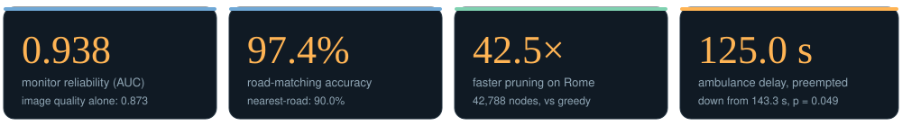
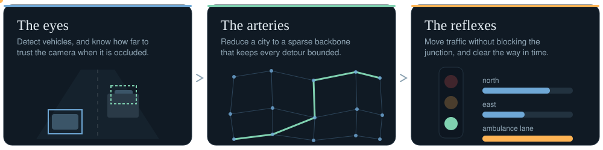

  
  
  

<h3 align="center">How does a city get an ambulance through when its cameras can fail and its streets are full?</h3>

Open-source research on seeing traffic, simplifying road networks and controlling signals. Every number links to a command that regenerates it, including the results that did not work.

## The system

## Research repositories

| Layer | Repository | Headline result |
|---|---|---|
| Eyes | [perception-reliability-monitor](https://github.com/soheylfalahzade/perception-reliability-monitor) | Reliability AUC **0.938**; alarm within 3 to 8 s of a real failure |
| Eyes | [occlusion-aware-queue-estimation](https://github.com/soheylfalahzade/occlusion-aware-queue-estimation) | Bias under occlusion **−2.84 m to −0.63 m** |
| Eyes | [ev-perception-for-preemption](https://github.com/soheylfalahzade/ev-perception-for-preemption) | Road matching **0.974** vs 0.900; ambulance passage 34.4 s to about 20 s in simulation |
| Eyes | [vision-travel-time-sensing](https://github.com/soheylfalahzade/vision-travel-time-sensing) | Association precision **0.875** vs 0.558 (appearance only) |
| Arteries | [geometric-spanners-lab](https://github.com/soheylfalahzade/geometric-spanners-lab) | 990 edges reduced to **77** (92.22% pruned), stretch at most 1.4 |
| Arteries | [Research_Geometric_ML_Optimization](https://github.com/soheylfalahzade/Research_Geometric_ML_Optimization) | Up to **42.5× faster** than greedy on Rome (42,788 nodes) |
| Arteries | [delay-bounded-spanner-networks](https://github.com/soheylfalahzade/delay-bounded-spanner-networks) | One backbone certified for all pairs, all 24 hours, 12 cities |
| Reflexes | [anti-gridlock-signal-control](https://github.com/soheylfalahzade/anti-gridlock-signal-control) | Ambulance delay **143.3 s to 125.0 s** with preemption (p = 0.049) |

## Computer vision and deep learning

<table>
<tr>
<td width="50%" valign="top"><b><a href="https://github.com/soheylfalahzade/Smart_Traffic_Vision">Smart_Traffic_Vision</a></b> Vehicle detection and tracking with YOLOv8.</td>
<td width="50%" valign="top"><b><a href="https://github.com/soheylfalahzade/Emergency_Vehicle_Recall">Emergency_Vehicle_Recall</a></b> Deep learning for identifying and prioritizing emergency vehicles in complex urban environments.</td>
</tr>
<tr>
<td width="50%" valign="top"><b><a href="https://github.com/soheylfalahzade/adaptive-its-priority">adaptive-its-priority</a></b> Adaptive traffic management for emergency-vehicle priority using hierarchical perception and hybrid CARLA and SUMO co-simulation.</td>
<td width="50%" valign="top"><b><a href="https://github.com/soheylfalahzade/vision-travel-time-sensing">vision-travel-time-sensing</a></b> Edge travel times from sparse camera re-identification, and their effect on spanner bounds.</td>
</tr>
</table>

## Where the data said no

- Knowing the camera had failed did not improve the signals in simulation.
- Detecting the ambulance earlier did not buy more time on a single queued approach.
- The learned spanner stopped pruning at Tokyo scale (0.09% of edges removed).
- The fuzzy controller is slower than both baselines when the bottleneck is loose.

## Working principles

- Every reported number is regenerated by a documented command with explicit seeds.
- Statistical claims carry intervals or paired comparisons; negative results are reported.
- Simulation and real data are never mixed without saying so.

## Stack

