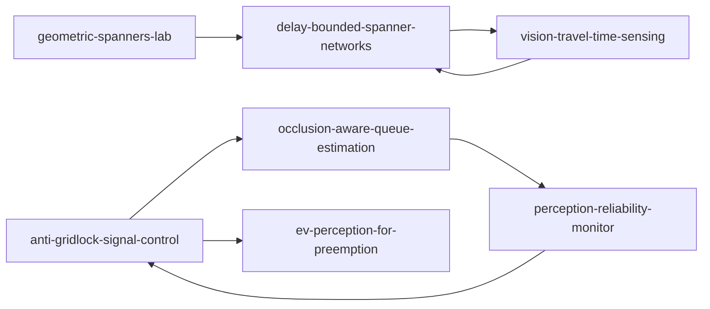

# Soheil Falahzade

Algorithms and perception for urban traffic networks: geometric spanners, signal control, and the camera-based sensing layer that feeds them. All repositories are open-source, tested, typed and reproducible from a single command; results are reported with their limitations.

## Graph and control

| repository | what it does |
|---|---|
| [geometric-spanners-lab](https://github.com/soheylfalahzade/geometric-spanners-lab) | benchmarks classical greedy geometric spanners on real-world OpenStreetMap road networks |
| [delay-bounded-spanner-networks](https://github.com/soheylfalahzade/delay-bounded-spanner-networks) | time-varying geometric spanners that extract a sparse urban backbone with bounded travel-time dilation over 24 h of traffic fluctuation |
| [anti-gridlock-signal-control](https://github.com/soheylfalahzade/anti-gridlock-signal-control) | local fuzzy-logic max-pressure control in SUMO to prevent junction spillback under heavy traffic |

## Perception layer

Each repository states what is simulated, what is measured, and which claims the evidence does not support (see the "Claims and evidence" and "Threats to validity" sections).

| repository | problem | headline result (simulation-based) |
|---|---|---|
| [occlusion-aware-queue-estimation](https://github.com/soheylfalahzade/occlusion-aware-queue-estimation) | lane-level queue length under occlusion from roadside cameras | systematic bias -2.84 m to -0.63 m; error 15-39% lower in occluded cases; no significant overall MAE change |
| [ev-perception-for-preemption](https://github.com/soheylfalahzade/ev-perception-for-preemption) | emergency-vehicle events on the road graph for signal preemption | map-matching accuracy 0.974 vs 0.900 (nearest edge); p95 1.9 ms per frame; paired SUMO study 34.4 s to about 20 s |
| [perception-reliability-monitor](https://github.com/soheylfalahzade/perception-reliability-monitor) | ground-truth-free reliability monitoring and graceful degradation | reliability AUC 0.938; closed-loop control benefit not supported in the studied setting |
| [vision-travel-time-sensing](https://github.com/soheylfalahzade/vision-travel-time-sensing) | edge travel times from sparse camera re-identification and their effect on spanner bounds | association precision 0.875 vs 0.558 (appearance only); edge MAPE 0.227 vs 0.256 (global level) |

## Working principles

- Every reported number is regenerated by a documented command with explicit seeds.
- Statistical claims carry intervals or paired comparisons; negative results are reported.
- Simulation and real data are never mixed without saying so.
